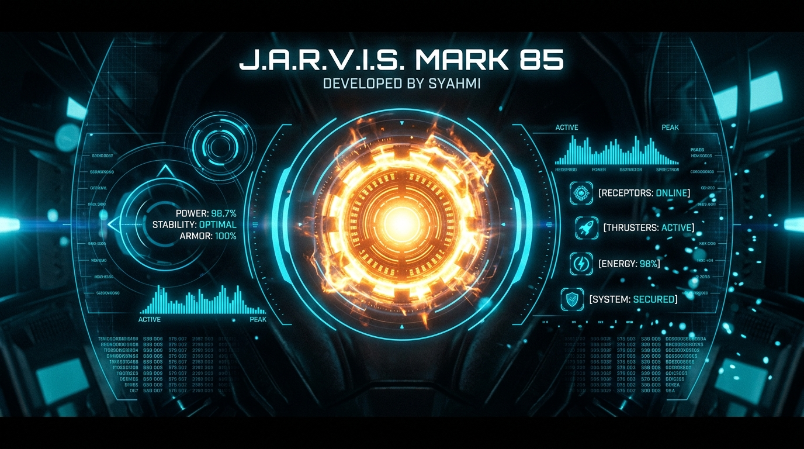

  <h1>J.A.R.V.I.S. // Mark 85</h1>
  
<strong>Iron Man Mark 85 Arc Reactor Holographic HUD & Autonomous Voice Assistant</strong>

  

    
    
    
    
  

  

    

  
<strong>An ultra-sleek, Iron Man holographic interface and autonomous hands-free voice assistant engineered by Syahmi.</strong>

  
<a href="https://jarvis.syahmiaof.my">Live Holographic Web HUD</a> • <a href="#-key-features">Features</a> • <a href="#%EF%B8%8F-tech-stack">Tech Stack</a> • <a href="#-architectural-highlights">Architecture</a>

---

## 💎 Project Overview

- **Functionality**: Full-stack autonomous voice assistant pairing a browser-based Arc Reactor HUD with a continuous conversational loop and dual-engine AI routing (Cloud OpenRouter & offline Ollama).
- **Aesthetic Value**: High-contrast obsidian glassmorphism with counter-rotating cyan and amber plasma energy rings, reactive audio waveform visualizer, and authentic Edge Neural British voice feedback.
- **Business Value**: Demonstrates zero-cost serverless AI deployment patterns, hands-free hardware interface orchestration, and edge voice latency optimization.

---

## ✨ Key Features

- **🦾 Minimalist Mark 85 Arc Reactor HUD:** Obsidian dark glassmorphism with counter-rotating cyan & amber plasma energy rings.
- **🎙️ Real-Time Dual-Language Speech Recognition:** Seamlessly understands **Bahasa Melayu** and **English** with zero typing required.
- **🔊 Microsoft Ryan Neural British TTS:** Authentic, crisp Iron Man Jarvis voice synthesis powered by Edge Neural Voice.
- **⚡ Hands-Free Continuous Conversational Loop:** Eliminates repetitive button pressing or claps—speak naturally back-and-forth.
- **🧠 Dual AI Engine (Zero Cost):**
  - **Cloud Intelligence:** OpenRouter Free Tier (*MiniMax M3.1 Flash / Qwen 2.5 / DeepSeek*).
  - **Local Hardware Intelligence:** Offline Ollama (*Llama 3.2 1B / Qwen 3.5 2B*).
- **🛡️ Cloud & Local Versatility:** Deployable on Vercel with serverless AI proxy or runnable completely offline on local laptop hardware.

---

## 🛠️ Tech Stack

  
  
  
  
  
  
  
  

---

## 🏛️ Architectural Highlights

- **Edge Audio Reactive Pipeline**: Audio frequency analysis mapped directly to Canvas 2D context render loops without layout thrashing.
- **Dual AI Gateway Fallback**: Serverless proxy pattern forwarding queries to OpenRouter with automatic local Ollama failover.
- **Speech Synthesis Stream Management**: Queued speech synthesis utterances with event-driven state synchronisation across listening, processing, and speaking states.

---

## 👑 Author

**Muhammad Syahmi**  
- GitHub: [@syahmiaof](https://github.com/syahmiaof)  
- Website: [syahmiaof.my](https://syahmiaof.my)  
- Project HUD: [jarvis.syahmiaof.my](https://jarvis.syahmiaof.my)

---

  Engineered with precision for autonomous AI interaction. J.A.R.V.I.S. Mark 85 Neural Matrix.

